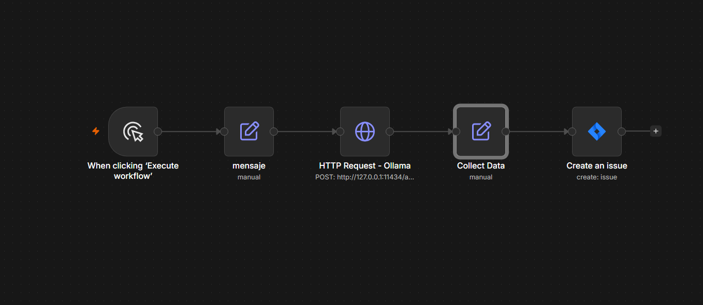

# n8n ticket triage

An n8n workflow that triages support messages with a local LLM (Ollama) and saves each one as a ticket (an issue) in Jira.

## How it works
Support message -> local model classifies it -> ticket is created.

## Stack
- n8n (self-hosted, runs on my own computer)
- Ollama with the model qwen3.5:9b
- Jira Software Cloud (free plan; each message becomes an issue)

## Results
I tested it with 15 sample support messages: N of 15 were classified correctly.

## Files
- workflow.json: the exported n8n workflow (no credentials included)
